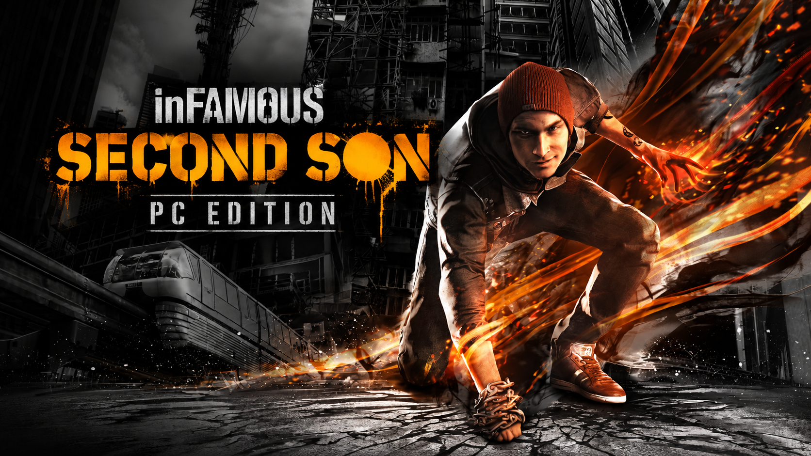
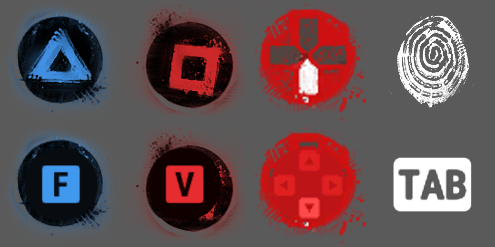
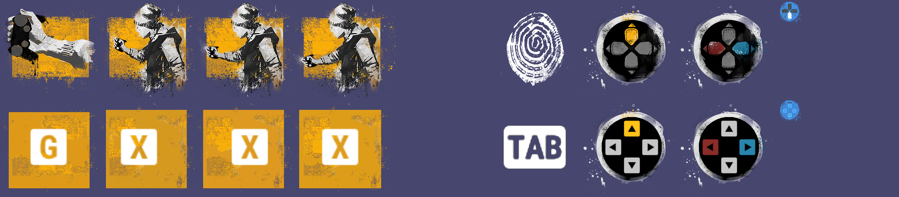

# inFAMOUS: Second Son — PC Edition

**A Windows PC port project for inFAMOUS: Second Son.**

An independent engineering project that runs the original PlayStation 4 game on Windows on its own runtime: its own loader, kernel, memory, threading, system services, GPU command processor, Vulkan backend and — step by step — its own GCN shader translator.

> **Status: in development, playable.** The game starts, loads saves and is played on the project's own runtime and Vulkan backend. Most PlayStation system services are native. What still comes from shadPS4 is listed exactly below; removing it is the current work.

<p align="center">
  
</p>

<p align="center">
  <a href="#where-the-project-is">Status</a> ·
  <a href="#what-is-new">What is new</a> ·
  <a href="#graphics">Graphics</a> ·
  <a href="#own-shader-translator">Shader translator</a> ·
  <a href="#performance">Performance</a> ·
  <a href="#input-and-button-prompts">Input</a> ·
  <a href="#architecture">Architecture</a> ·
  <a href="#known-issues">Known issues</a> ·
  <a href="#roadmap">Roadmap</a>
</p>

---

## Overview

The project began as a launcher on top of the shadPS4 emulator core and has been replacing it piece by piece. Today the game runs on SecondSonPC's own code for nearly everything that matters at run time; shadPS4 is still linked into the build and provides a shrinking set of functions (below).

It is not a remake and not a source-code reconstruction: the original executable and assets are used unchanged. The project replaces the platform underneath them.

All numbers in this file were measured on the development machine (RTX 2060, Windows 10, 32 GB RAM) in fixed test scenes, unless stated otherwise.

## Where the project is

### PlayStation functions the game imports

The game imports 417 system functions. Their owner in the current build (snapshot `docs/generated/CALLS.md`, 2026-10-18):

| Owner | Functions | Called in a 2-minute gameplay run |
|---|---:|---:|
| **Native (SecondSonPC)** | **336** | 163 |
| shadPS4 (bridge) | 61 | 8 |
| shadPS4 common stub | 20 | 1 |

The bridge functions the game actually calls: `sceAjmInitialize`, `sceAjmModuleRegister` (audio decoding), `sceCommonDialogInitialize`, `sceNetInit`, `sceNetPoolCreate`, `sceNetInetNtop`, `sceLibcHeapGetTraceInfo`, `fflush`; the common stub: `vprintf`.

### Components

| Component | State |
|---|---|
| Executable, loader (SELF/ELF, relocations, TLS, NID table) | Own |
| Kernel: threads, synchronization, time, event queues, virtual / direct memory | Own, on by default |
| Exception handling, CPU patcher (TCB / FS patches) | Own, on by default |
| File system, system / user services, PlayGo, app content | Own |
| Save data (`param.sfo` byte-identical to the bridge's in tests) | Own |
| Audio output (WASAPI) | Own |
| Video decoding (`sceVideodec*`, cutscenes) | Own |
| Offline network, NP, trophies, HTTP | Own (offline behaviour) |
| Keyboard / mouse input, pad API | Own |
| GPU: PM4 command processor | Own |
| GPU: Vulkan backend (default `--gpu-backend sspc`) | Own |
| Shader translation GCN → SPIR-V | Own, by default for compute, vertex and pixel programs; shadPS4's recompiler is kept only as an A/B reference (`SSPC_OWN_SHADERS=bridge`) |
| Ajm / ATRAC9 audio decoding | shadPS4 |
| Common dialogs, a few network / libc functions | shadPS4 |
| Build without `third_party/shadPS4` | Not yet |

## What is new

The main changes since the first public description:

- **Own Vulkan backend is the default.** The game's GPU command buffers are processed by SecondSonPC's PM4 command processor and recorded into Vulkan by its own executor; the bridge renderer is only a fallback (`--gpu-backend bridge`).
- **Own shader translator by default.** Compute, vertex and pixel programs (and the auxiliary stages of rect/quad lists) are translated by SecondSonPC's GCN → SPIR-V translator; 0 programs fall back to the bridge in the test scenes (details below).
- **City performance (CITY-OPT).** In the open city (~12 000 draws per frame) the engine's own draw functions now tag their draws, and runs of draws that differ only in geometry are processed and recorded as one unit: **+16 % FPS** in the city on top of the earlier city optimizations (details under Performance).
- **Shader cache and preparation window.** Translated shaders and Vulkan pipelines are stored on disk; before the game starts, a preparation window predicts and builds the pipelines the game will need, from the game's own data files (no save scanning).
- **Upscaling and frame generation.** DLSS Super Resolution, AMD FSR 3.1 Super Resolution and FSR 3.1 Frame Generation inside the game's frame.
- **Frame pacing.** The emulated 59.94 Hz vblank was the cap of the 1 % lows; the presenter now paces freely with a frame-rate limit (default 60, up to unlimited). The game's clock was measured to be independent of FPS.
- **Rendering fixes:** light glow through walls (real occlusion queries), flickering smoke (particle sort race), lighting colour channels.
- **Button prompts follow the input device** — keyboard/mouse, Xbox or PlayStation.
- **Native audio output (WASAPI), video decoding and save data.**

## Graphics

### Own command processor and Vulkan backend

- PM4 packets of the game's command buffers are decoded and executed by SecondSonPC (graphics and async compute queues).
- Resources, descriptors, GPU memory import, synchronization, barriers by ranges, write-back of GPU results the game reads.
- Two-thread mode: command processing and Vulkan recording on separate threads.
- Vulkan Validation and Synchronization Validation were clean in the documented test scenes.

### Rendering fixes

| Problem | Cause | Fix |
|---|---|---|
| Vehicle-light glow visible through fences and walls | visibility queries always reported "fully visible" | real Vulkan occlusion queries, results given to the game's compute shader (`146a3bd`) |
| Smoke flickering | the particle sort merged all widths in one dispatch; on PS4 that is one 64-lane wave, on PC two 32-lane subgroups raced | one dispatch per merge level with a barrier (`01a3edd`) |
| Wrong lighting colours | colour target component swap was masked out | COMP_SWAP honoured |

### Shader cache, pipeline prediction

- Disk cache of translated SPIR-V with reflection, plus `VkPipelineCache` (`vulkan.bin`) with device/driver checks.
- Static prediction: shader programs, descriptor layouts and pipeline states are derived from the game's pack files and engine structures. Hold-out accuracy for whole pipelines of render passes: 87–90 %; compute ~87 % of keys.
- A preparation window builds them before the game starts (a repeat start takes ~2 s).

### Upscaling and frame generation

Native backend only. The upscaler replaces the game's own (PS4 Pro-style) scaling pass; the HUD is drawn afterwards at full resolution and never goes through the upscaler. Motion vectors, reversed depth and jitter are taken from the game's frame.

| Mode (RTX 2060) | Village FPS / 1 % low | Beach FPS / 1 % low |
|---|---|---|
| Native | 35.4 / 25.8 | 41.6 / 28.0 |
| DLSS Quality | 36.3 / 27.8 | 38.8 / 26.8 |
| FSR Quality | 38.7 / 29.2 | 44.7 / 29.3 |
| FSR Performance | 40.7 / 29.2 | 45.3 / 29.3 |

FSR 3.1 Frame Generation: beach 43–53 game frames/s → 86–105 shown; the HUD is kept out of generated frames. DLSS Frame Generation is not implemented (needs RTX 40/50). Generated frames still need visual review.

## Own shader translator

SecondSonPC's GCN → SPIR-V translator (`src/runtime/gpu/gcn/`): decoder, control-flow graph, structurization, resource analysis with its own SRT walk, and a SPIR-V emitter. It follows the bridge's binding and interface conventions, so its modules can be mixed with the bridge's in one pipeline, and decides per program: an instruction or shape it does not handle sends that program to the bridge's recompiler with the reason logged.

**It is the default** for compute, vertex and pixel programs. `SSPC_OWN_SHADERS` selects a subset (`cs`, `vs`, `ps` in any combination); `SSPC_OWN_SHADERS=bridge` (`play_rea_bridge.cmd`) uses the bridge's recompiler for everything — kept as the A/B reference.

| Stage | Own / sent to the bridge (2- and 6-minute gameplay runs) | `spirv-val` |
|---|---:|---|
| Compute | 95 / 0, 103 / 0 | all valid |
| Vertex (incl. rect / quad lists) | 133 / 0, 149 / 0 | all valid |
| Pixel | 369 / 0, 516 / 0 | all valid |
| Auxiliary tessellation stages for rect / quad lists | 10 quad modules in game | all valid |

Offline, over all 10 301 GCN programs in the game's files: 7 934 modules emitted in the offline test form, all valid (the rest need the game's runtime state, which only the game supplies). Vulkan Validation with Synchronization Validation: 0 messages with the own stages. The picture was checked in game against the bridge's translation. Details: `docs/OWN_SHADER_TRANSLATOR.md`.

## Performance

The frame is currently limited by **CPU-side command processing and Vulkan recording**, not by the GPU: the open city issues ~12 000 draws per frame, the GPU needs ~18 ms of it. Cutscenes with ~1 200 draws run at 60–90 FPS.

Measured improvements (A/B, n = 3, before → after):

| Change | Beach | Harbour | Village |
|---|---|---|---|
| GPU optimizations (`3da31cf`) | 48.1 → 55.1 FPS | 42.6 → 49.9 FPS | 37.3 → 38.6 FPS |
| Free frame pacing, 1 % low (`2f984a9`) | 29.4 → 48.8 | 29.4 → 46.8 | 29.3 → 35.3 |

**City (CITY-OPT, `SSPC_CITY_PERFORMANCE=1`).** The city's ~12 000 draws per frame went through command processing and Vulkan recording one by one. The engine's two main draw functions (meshes and shadow casters, ~70 % of the draws) are now tagged by small hash-pinned probes in the driver NOP that follows every draw — no extra command dword, the game's code unchanged — and a run of tagged draws that differ only in geometry and instance constants is one record: the first draw is prepared and recorded in full, the others only bind their own vertices, indices and constants. Interleaved runs, n = 3, city:

| City | FPS | 1 % low | command processing | Vulkan recording thread |
|---|---|---|---|---|
| before (Phase 1–3 preset) | 25.3 (24.9–25.9) | 17.5 | 33.3 ms | 36.7 ms |
| with engine draw runs | **29.4 (28.9–30.5)** | **21.4** | 31.5 ms | **27.7 ms** |

Checked: every joined draw also prepared in full and compared (21.9 M draws, 0 different), the command processor's registers against the recording thread's copy (0 different), Vulkan Validation + Sync (0 messages), frame captures (depth and shadow maps bit-exact). Details: `docs/CITY_ENGINE_OPTIMIZATION.md`, `docs/CITY_PERFORMANCE.md`.

Phase 6 brings the G-buffer's instanced draws (`0x1a1770`) into runs too. The engine's constant update engine copies a stage's resource table to new memory at every commit, so a member's shader resource walk is redone with its new registers. A second probe on the material setup (`0x448640`) turns a material change into an immediate refusal. Preset with and without it, interleaved, n = 3, city: **27.9 → 31.6 FPS**, 1 % low 24.2 → 26.6, command processing 34.1 → 30.3 ms (better in every round); the beach is not slower and the village unchanged. Checked: 23.1 M members also prepared in full (0 different), depth and shadow maps bit-exact, the G-buffer, normals, lighting and final frame within the scene's frame-to-frame noise, Vulkan Validation + Sync (0 messages from command recording). Details: `docs/CITY_ENGINE_RESOURCES.md`.

Performance work is done by controlled A/B runs; rejected experiments are documented (`docs/GPU_OPTIMIZATION.md`, `docs/FRAMEBREAK.md`, `docs/LIGHTING_PROFILE.md`). No quality setting, light or shadow is reduced to gain FPS.

## Native audio, video and saves

- **Audio output** through WASAPI (`245d86d`); `--bridge audio` switches back to the bridge's output.
- **Video decoding** (`sceVideodec*`) is native; cutscenes play.
- **Save data**: existing saves load and autosaves are written; tests always run on copies of the user's saves.

## Input and button prompts

Keyboard and mouse are handled natively, with PC key bindings. The game draws every button prompt from one icon font; SecondSonPC redraws the physical-button cells for the active input device, so **all** prompts of the game — static and composite, in every language — switch between keyboard/mouse, Xbox and PlayStation without editing strings or replacing the original files on disk.

<p align="center">
  
</p>

<p align="center">
  
</p>

The original PlayStation icons stay when a PlayStation controller is used.

## Architecture

```text
Original PS4 game (eboot.bin + modules, unchanged)
        |
        v
SecondSonPC loader and runtime
        +-- kernel: threads, sync, time, event queues
        +-- virtual / direct memory, exception handling, CPU patcher
        +-- file system, system / user services, PlayGo
        +-- save data, WASAPI audio, video decoding
        +-- offline network / NP / trophies
        +-- [shadPS4 bridge: Ajm, common dialogs, a few net / libc functions]
        |
        v
SecondSonPC GPU
        +-- PM4 command processor (graphics + async compute)
        +-- shader frontend: SRT walk, resource plans, specialization keys
        +-- GCN -> SPIR-V: own translator (default; bridge recompiler as A/B reference)
        +-- engine draw runs: hash-pinned probes tag the engine's draws (CITY-OPT)
        +-- shader + pipeline disk cache, static pipeline prediction
        +-- Vulkan executor: descriptors, memory import, barriers, write-back
        +-- presenter: frame pacing, DLSS / FSR upscaling, FSR frame generation
        |
        v
Vulkan driver
```

## Known issues

- FPS is bound by CPU command processing in dense scenes (foliage, city streets): ~30 FPS in the open city on the development machine, far from 60.
- Ajm / ATRAC9, common dialogs and a few network / libc functions still come from shadPS4; the build still needs `third_party/shadPS4`.
- On a machine without a page file, total committed memory can reach the Windows limit in long sessions (32 GB RAM); fixed causes are documented in `docs/KNOWN_ISSUES.md`, long-session soak testing continues.
- Frame generation has not been reviewed frame by frame; input latency with it is not measured.
- No full-campaign compatibility guarantee.

## Roadmap

### Runtime and services
- [x] Own loader, kernel, threads, memory, exceptions, CPU patcher
- [x] File system, system services, save data, offline network / trophies
- [x] WASAPI audio output, video decoding
- [ ] Ajm / ATRAC9 decoding
- [ ] Common dialogs, remaining network and libc functions

### Graphics
- [x] Own PM4 command processor and Vulkan backend (default)
- [x] Occlusion queries, smoke and lighting fixes
- [x] Shader / pipeline disk cache, static pipeline prediction, preparation window
- [x] DLSS / FSR 3.1 upscaling, FSR 3.1 frame generation
- [x] Free frame pacing
- [x] City: draw runs from the engine's draw functions (CITY-OPT, +16 % FPS)
- [ ] Faster command processing for the remaining draws (the current FPS limit)

### Own shader translator
- [x] Compute programs
- [x] Vertex programs
- [x] Pixel programs: interpolation, colour / depth exports, implicit-LOD sampling
- [x] Rect / quad lists and auxiliary stages (quad lists seen in game; rect lists only validated offline)
- [x] Own translator by default
- [ ] Other districts, fights and story scenes run through the own translator

### Independence
- [ ] Remove the bridge (`src/bridge/shadps4`)
- [ ] Build without `third_party/shadPS4`
- [ ] Validate gameplay, saves, audio, video and graphics against a controlled baseline

## Installation

**This project does not distribute the original game, its executable, assets, firmware or any copyrighted content.** A legally obtained copy of the game is required; you prepare your own game files.

Development builds are started with the scripts in the repository root (`play.cmd`, `play_native.cmd`, `play_rea.cmd`, `play_rea_own.cmd`). Their names and arguments change during development. Requirements: 64-bit Windows, a Vulkan 1.3 GPU and driver, the user's own game files. A tested public build and its setup procedure are not published yet.

## Contributing

Reproducible bug reports, traces and documentation fixes are welcome. For performance changes: record a baseline, change one thing at a time, check rendering and Vulkan validation, report average FPS and 1 % lows, and document failed experiments. Do not submit game dumps or any proprietary game content.

## Legal notice

This is an independent, unofficial project and is not affiliated with, endorsed by, or sponsored by Sony Interactive Entertainment or Sucker Punch Productions.

inFAMOUS and inFAMOUS: Second Son are trademarks and/or copyrighted works of their respective owners.

No original game content is distributed by this repository. Users must supply their own legally obtained game files.

Third-party components, including the parts of shadPS4 still used during the migration, remain under their own licences.

## Acknowledgements

- The shadPS4 project, whose emulator core the port started from.
- The authors and maintainers of the open-source tools and Vulkan libraries used here.
- Researchers documenting PlayStation 4 hardware, GCN and executable formats.

## Disclaimer

Experimental software: features may be incomplete and regressions may occur. Back up your save data before testing a development build.
