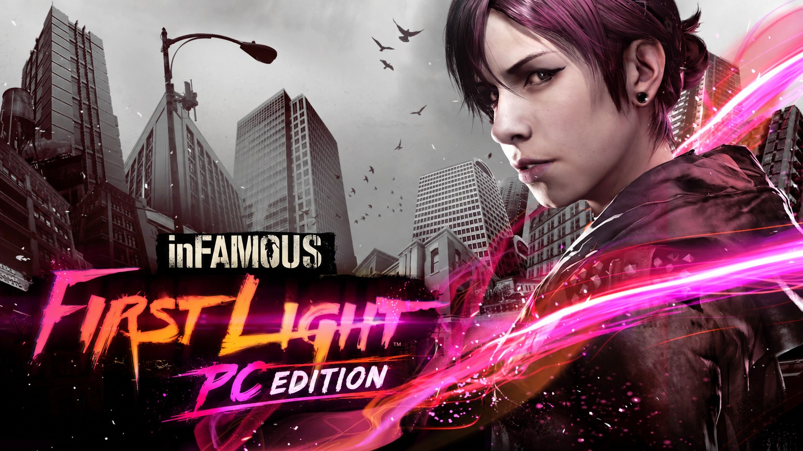
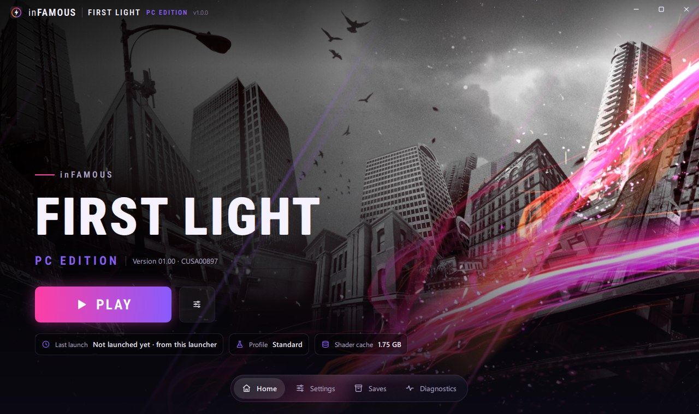
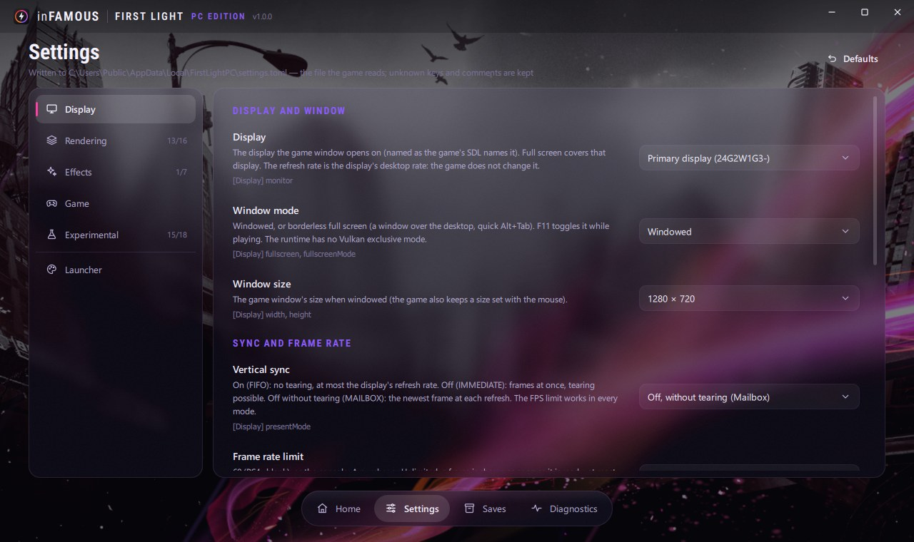
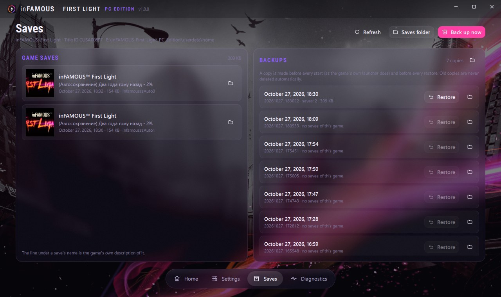
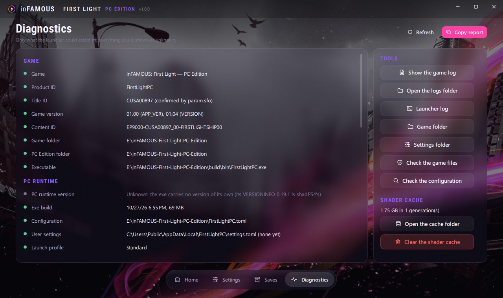

# inFAMOUS: First Light — PC Edition

**inFAMOUS: First Light on Windows, on the runtime of [inFAMOUS: Second Son — PC Edition](https://github.com/kam0n4ik/inFAMOUS-Second-Son-PC-Edition).**

The original PlayStation 4 game runs on Windows; its executable and data are left unchanged. Both games share one engine, so First Light is a second product of the same runtime: its own loader, kernel, memory manager and system services, its own GPU command processor, Vulkan 1.3 backend and GCN → SPIR-V shader translator. The game's own x86-64 code runs directly on the PC's processor: there is no CPU emulation.

> **Status: early, the game reaches gameplay.** First Light starts, plays its intro and cutscenes, and is played in the open world. On the development PC (Ryzen 5 5500, RTX 2060 6 GB, 720p window) the first sessions ran at about 35–45 FPS; there is no reproducible benchmark yet, so no FPS figure here is a promise. See [Known issues](#known-issues).

<p align="center">
  
</p>

<p align="center">
  <a href="#installation">Installation</a> ·
  <a href="#launcher">Launcher</a> ·
  <a href="#requirements">Requirements</a> ·
  <a href="#how-it-relates-to-second-son">Shared runtime</a> ·
  <a href="#frame-rate">Frame rate</a> ·
  <a href="#building-from-source">Building</a> ·
  <a href="#known-issues">Known issues</a> ·
  <a href="https://github.com/kam0n4ik/inFAMOUS-Second-Son-PC-Edition">Second Son — PC Edition</a>
</p>

---

## How it relates to Second Son

This repository is the Second Son runtime with First Light's own parts added; nothing of it is a renamed copy. The product is chosen at build time (`SSPC_PRODUCT=FirstLight|SecondSon`, `build.ps1 -Product`), and one tree builds both `FirstLightPC.exe` and `SecondSonPC.exe`, so a fix in the shared runtime reaches both games.

What First Light has of its own:

| Part | What |
|---|---|
| Import table | every import of First Light's `eboot.bin` (608 rows), 46 of them not used by Second Son (`src/loader/generated/import_table_cusa00897.inc`) |
| System libraries | SaveData Transferring Mount, NpScore / NpTus / NpWebApi (answered as "not signed in"), libSceRtc |
| Engine hooks | game menu, game fixes, mouse camera, resolution and HUD, render size switch, FOV, TAA: First Light's own addresses, each checked against a hash of the original function; on any other executable a hook is not installed and the original code runs |
| Button prompts | First Light's icon atlas and button pictures, redrawn for keyboard, Xbox or PlayStation |
| Shader preparation | Second Son's shader templates cover about 89 % of the layouts First Light used in a session; they are compiled before the game starts |
| Files, saves, settings | `FirstLightPC.toml`, `%LOCALAPPDATA%\FirstLightPC\`, saves under `userdata\` of the game's folder: nothing is shared with Second Son |

Second Son's engine-specific optimisations (effects quality, CITY-OPT engine tags, early submission, the native engine reconstruction) are tied to Second Son's executable and are off on First Light until they are mapped and measured on it.

## Installation

**This project does not distribute the game, its executable, assets or any copyrighted content.** You need your own, legally obtained copy of inFAMOUS: First Light and must prepare its files yourself.

1. **The game's folder.** A decrypted dump of your copy of **CUSA00897**: one folder with `eboot.bin`, `sce_module`, `sce_sys` and `art`. No PS4 firmware files are needed.
2. **FirstLightPC.** Download `FirstLightPC-win64.zip` from [Releases](../../releases), or [build it](#building-from-source), and copy everything in it **into the game's folder**, next to `eboot.bin`. None of the game's files are replaced.

   | File | What |
   |---|---|
   | `FirstLightPC.exe` | the runtime; started on its own it opens the [launcher](#launcher) first |
   | `Launcher\` | the inFAMOUS PC Launcher (Qt): settings, saves, diagnostics, Play |
   | `play.cmd` | starts the game at once with the improvements that are on for players, after backing up the saves |
   | `play_safe.cmd` | the game without the performance switches, to compare when something looks wrong |
   | `FirstLightPC.toml` | defaults: window, language, keys, PC settings |
   | `data\static_templates.txt` | the data the shader preparation predicts the game's shaders from |
   | `sspc_dlss.dll`, `nvngx_*.dll`, `sl.*.dll`, `NvLowLatencyVk.dll`, `amd_fidelityfx_vk.dll` | DLSS, Streamline, Reflex, FSR 3.1 |
   | `fonts\`, `licenses\` | the menu fonts and the vendors' licences |
   | `FirstLightPC-README.txt` | these steps in short |

3. **The Visual C++ runtime.** Install the [Microsoft Visual C++ 2015–2022 Redistributable (x64)](https://aka.ms/vs/17/release/vc_redist.x64.exe) if it is not installed yet.
4. **Start `FirstLightPC.exe`** and press **Play** in the launcher; `play.cmd` still starts the game at once. On the first start a console window prepares the game's shaders (about 3.5 minutes on 6 cores / 12 threads, about 13 200 pipelines, once); later starts skip it.
5. **PC settings:** in the launcher, or **F1** in the game: resolution and aspect ratio, FOV, the frame-rate limit (up to unlimited), anti-aliasing, mouse and keys.

| Path | What |
|---|---|
| `userdata\` (in the game's folder) | saves; `play.cmd` copies them to `userdata\savedata_backups\<date_time>` before every start |
| `%LOCALAPPDATA%\FirstLightPC\settings.toml` | your changes from the launcher and the in-game settings (they override `FirstLightPC.toml`) |
| `cache\shaders\` | prepared shaders and the driver's pipeline cache (about 1.9 GB; safe to delete, it is prepared again) |
| `logs\FirstLightPC.log` | the log; attach it to a bug report. `FirstLightPC.shaders.log` is the shader preparation's |

## Launcher

`FirstLightPC.exe` started without arguments opens the inFAMOUS PC Launcher from `Launcher\`, the same launcher Second Son uses: it finds the game from its folder and shows First Light's own art and colours. **Play** starts the game with what is chosen there. It is in English and Russian: it follows Windows' display language, and Settings → Launcher switches it.

<p align="center">
  
</p>

- **Settings** are the game's PC settings by section, written to `%LOCALAPPDATA%\FirstLightPC\settings.toml`, the file the game reads. What does not work on First Light yet (effects quality, Second Son's engine experiments) is shown inactive with the reason; what is done in code but not yet checked in play is marked so.
- **Saves** lists the game's saves with their own titles, and the backups made before every start; any backup can be restored.
- **Diagnostics** shows what was found: the game's serial and version, the folders, the runtime, the GPU; the report can be copied for a bug report.
- The background is the game's own art (`sce_sys\pic0.png` of your copy), read from the game's folder, not shipped.
- `play.cmd` and any command line with arguments start the game at once; `FirstLightPC.exe --launcher` opens the older built-in launcher. Without `Launcher\` the built-in one opens.

<p align="center">
  
</p>

<p align="center">
  
</p>

<p align="center">
  
</p>

The launcher's source is in `pc-launcher\` (Qt 6, [pc-launcher/README.md](pc-launcher/README.md)).

## Requirements

The same as Second Son's: Windows 10 or 11 64-bit; an x86-64 CPU with **AVX**, F16C, BMI1, LZCNT and MOVBE (any AMD Ryzen, or an Intel Core of the 4th generation or later); a Vulkan 1.3 GPU (tested: NVIDIA GeForce RTX 2060 6 GB); the Windows page file on. AMD and Intel GPUs have not been tested.

## Frame rate

The frame-rate limit (F1 → Display) goes from 30 to 240 FPS or unlimited. First Light's game clock (`eboot.bin` 0x14bd60) was read: like Second Son's, a frame's step is real time from the CPU's time stamp counter, at most 1/30 s, so the world does not speed up at a high frame rate. This is from reading the code; physics and animation above 60 FPS have not been checked in play yet.

Cutscenes are videos recorded at 30 frames per second, as on the PS4: the frame-rate limit does not change them.

## Building from source

This repository holds what builds the runtime: `src/`, `cmake/`, `patches/`, `assets/`, `third_party/spirv_headers`, `CMakeLists.txt` and `build.ps1`; plus the files that go into the game's folder: `game-first-light/` (First Light) and `game/` (Second Son, and the shader templates both games use). The porting documents (audit, compatibility matrix, architecture, plan, boot report, performance baseline, TODO) and their tools are kept at the tag [`archive/docs-first-light-20261027`](../../tree/archive/docs-first-light-20261027).

You need Git, Visual Studio 2022 or Build Tools 2022 (*Desktop development with C++*, Windows 11 SDK), LLVM 20 or later (`clang-cl`, `lld-link`), CMake 3.24+ and Ninja (both come with Visual Studio), and about 8 GB of disk.

```powershell
git clone https://github.com/kam0n4ik/inFAMOUS-First-Light-PC-Edition.git
cd inFAMOUS-First-Light-PC-Edition
powershell -ExecutionPolicy Bypass -File build.ps1
```

`build.ps1` clones shadPS4 into `third_party\shadPS4` at the pinned commit `0fe263a4760d` with its submodules (the configure step applies `patches\shadps4`), sets up the compiler environment, builds `build\bin\FirstLightPC.exe` and packs `dist\FirstLightPC\` and `dist\FirstLightPC-win64.zip`. `-Product SecondSon` builds `SecondSonPC.exe` into `build-secondson\` from the same tree. Other options: `-Config RelWithDebInfo|Release|Debug`, `-Fresh`, `-NoPackage`.

DLSS and FSR need the vendors' SDKs in `third_party\upscalers`, laid out as in [Second Son's README](https://github.com/kam0n4ik/inFAMOUS-Second-Son-PC-Edition#dlss-and-fsr-optional); without them the build works, with no upscalers.

## Known issues

- **White silhouettes after a cutscene.** Bright cut-outs of characters stayed on the ground after a cutscene: a render target the game clears with a fast clear was not cleared before it was read. Fixed in this version (the log shows `fast clear elimination`); not yet confirmed in a full playthrough.
- **The PC settings from the game's menu.** Esc → Settings → "Additional settings" is not mapped on First Light yet; F1 opens the PC settings.
- **Effects quality settings** (smoke, particles, shadows, textures, reflections, rain, post-effects) act through Second Son's engine hooks and do nothing on First Light yet.
- **Shader translation:** about 200 of First Light's shader programs are not prepared ahead (sampling without a sampler descriptor); they compile when first seen.
- **libSceJson2** is a stub: only its allocator is called so far.
- Saves, trophies' texts and the DLSS / FSR path have not been checked on First Light.

## Legal notice

This is an independent, unofficial project and is not affiliated with, endorsed by, or sponsored by Sony Interactive Entertainment or Sucker Punch Productions. inFAMOUS and inFAMOUS: First Light are trademarks and/or copyrighted works of their respective owners. No original game content is distributed by this repository; users must supply their own legally obtained game files.

Third-party components remain under their own licences. These include shadPS4 (GPL-2.0) and its libraries; the NVIDIA DLSS SDK, Streamline and Reflex; and the AMD FidelityFX SDK, whose licence texts are in `licenses\` of the release package. The Roboto fonts are under the OFL / Apache 2.0.

## Acknowledgements

- The shadPS4 project, whose emulator core the port started from and still builds on.
- Ghidra, LLVM and the authors of the open-source Vulkan tools and libraries used here.
- Researchers documenting PlayStation 4 hardware, GCN and executable formats.

## Disclaimer

This is experimental software: features may be incomplete and regressions may occur. Back up your save data; `play.cmd` does it before every start.
