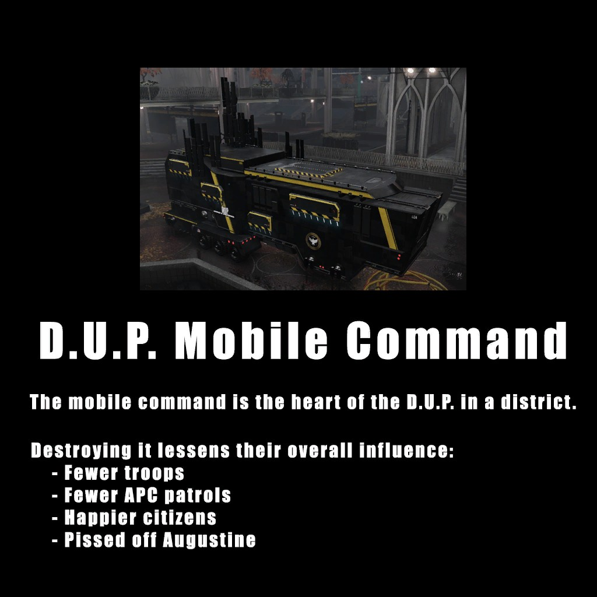
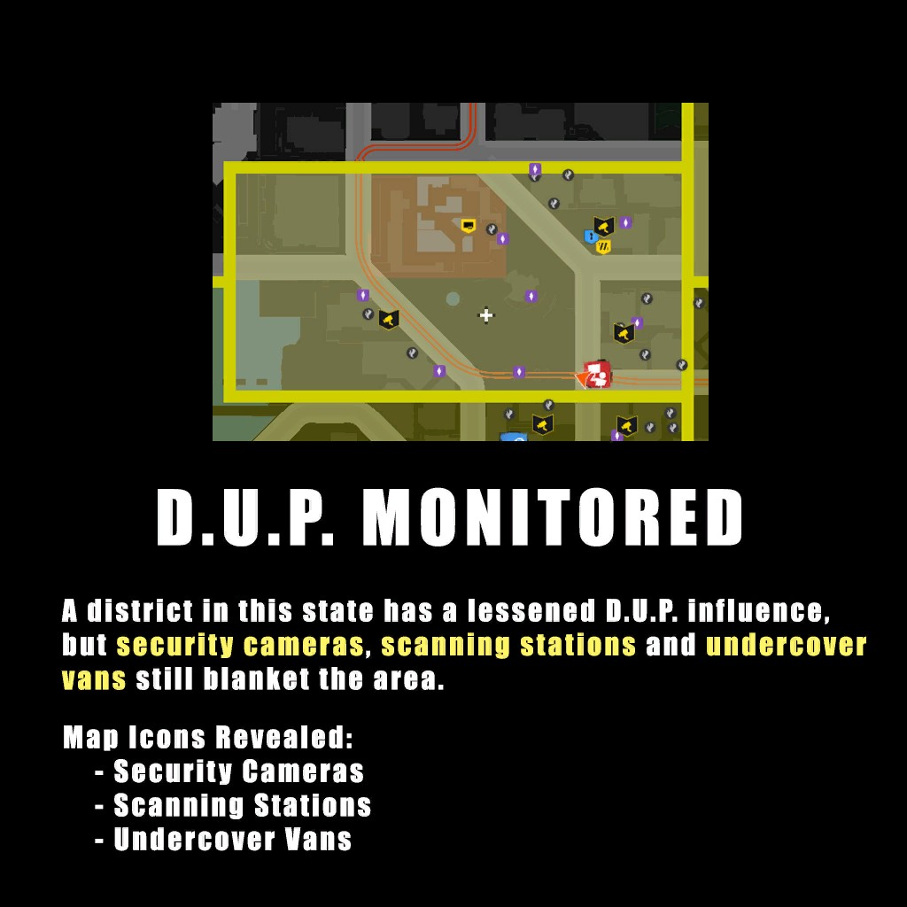
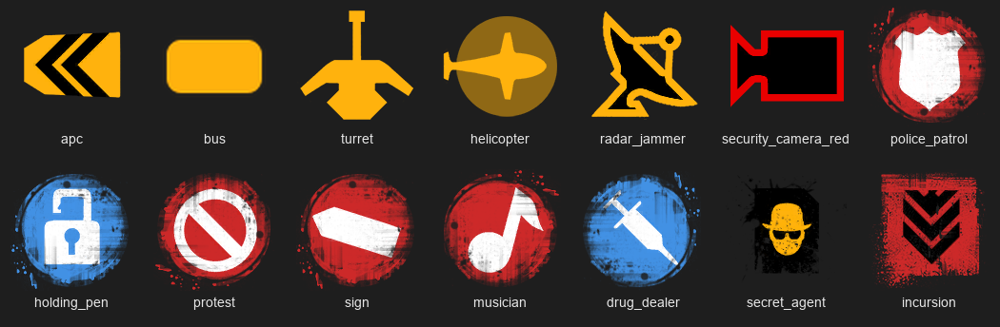
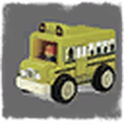
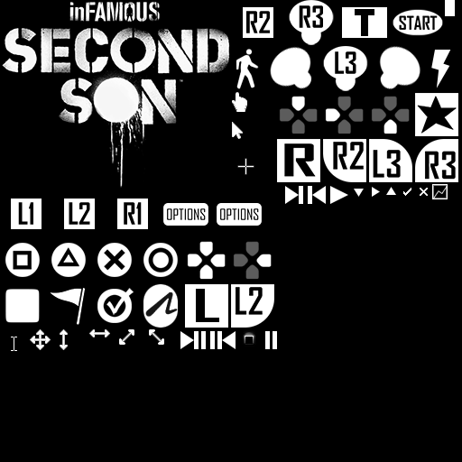
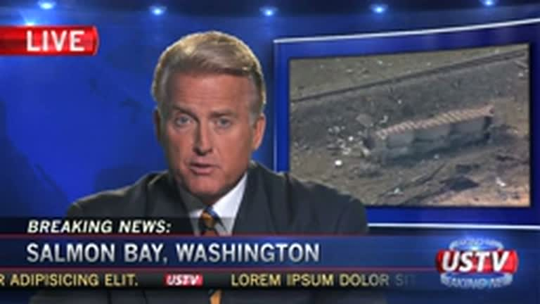
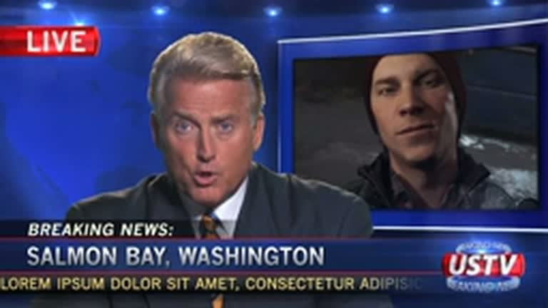

# Вырезанный материал inFAMOUS Second Son

[English](README.md) · **Русский**

> [!WARNING]
> **Спойлеры.** Здесь разбирается весь сюжет inFAMOUS Second Son, включая выборы и концовки, а реплики и ролики раскрывают повороты сюжета. Если вы ещё не прошли игру, сначала пройдите её.

Всё ниже найдено в файлах самой игры: `eboot.bin`, пакеты `art\cache\*.xpps`, архивы озвучки `art\cache\psarc\*.psarc`, ролики `art\movies`. Исследовалась версия **«retail 0212.1422 i3_eu ship»**, европейская розничная сборка (CUSA00004). Внутреннее имя игры — **i3**, то есть inFAMOUS 3.

«Не используется» здесь значит, что на файл или текст нет ни одной ссылки ни в коде игры, ни в данных миссий. Ссылки искались и по имени, и по хешу имени (h·101). Это сильный признак вырезанного, но не стопроцентная гарантия: в редких случаях игра собирает имя на ходу.

Озвучка взята из игры на двух языках: `_en.mp3` — оригинал, `_ru.mp3` — официальный русский дубляж.

**Содержание:** [Сюжет](#сюжет) · [Миссии и задания](#миссии-и-задания) · [Активности в районах](#активности-в-районах) · [Силы](#силы) · [Системы и сложность](#системы-и-сложность) · [Досье ДЕЗа](#досье-деза) · [Трофеи](#трофеи) · [Ролики](#ролики) · [Бета, демо, отладка](#бета-демо-отладка) · [Как это искалось](#как-это-искалось)

---

## Сюжет

### Банда «Акуран» была русской мафией

Внутри игры банда до сих пор называется `russians` и `siberians`:
- отдельный пакет персонажей `russians.xpps`;
- анимации `RussianTaunt`, `RussianCall`, `RussianMelee`;
- сообщения «Банда Акул уничтожена» и «ЧЛЕН БАНДЫ АКУЛ» в коде называются `u_gain_russians` и `u_legend_angry_russians`;
- миссия Юджина по зачистке банды: `vde_ambush_siberians`, `vde_eliminate_siberians`, реплики `deadsiberian`.

Остались реплики, где их прямо называют русскими:

| Кто | Оригинал | Русская версия |
|---|---|---|
| Делсин | *Better find that poor SBT on the crane before those blood-thirsty **Russians** do.* | «Надо бы найти этого бедолагу на кране, пока **русские** его не разорвали». |
| Делсин | *So Eugene, I just smashed up a bunch of those obnoxious **Russian** Akuran guys…* | «Юджин, я тут прихлопнул пару доставучих **русских** Акул…» |
| Делсин | *…ripping the intestines out of these **eastern bloc** loud mouths…* | «…потрошу потихоньку этих **нетолерантных бандюков**…» (в переводе смягчили) |
| Бандит | *Ha ha, they do not understand English!* | |
| Бандит | *Yeah, maybe you could teach them English!* | «Ага, а вот давай-ка мы их щас научим!» |
| Бандит | *Hey painter, how about if I paint your face with my fist?!* | «Слышь, маляр, щас я тебе мигом всю рожу размалюю!» |
| Бандит | *Look out! The painter has a sword!* | «Берегитесь! У маляра меч!» |

🔊 [`audio/russians_ru.mp3`](audio/russians_ru.mp3) · [`audio/russians_en.mp3`](audio/russians_en.mp3)

### Энергоядра (Blast Cores) вместо ретрансляторов

То, что Делсин поглощает ради бетонных сил, в финале называется *Core Relay* («ретранслятор»). Раньше это были **Blast Cores**, как в первых частях серии. Следы остались в нескольких текстах: «ДЕЗ отправляет большой отряд, чтобы вернуть **энергоядро**», «Gotta drain that Blast Core», «I need a blast core!».

Целиком сохранилась вырезанная сцена из **первой миссии**: Делсин трогает ядро и получает новую силу.

> **Делсин:** Ух ты… Синенькое.
> **Реджи:** Эй, эй, эй, эй, ты что делаешь?! Делсин, господи, ты живой?!
> **Делсин:** Помнишь, я потрогал того потного лысого мужика и обрел суперсилу? …Хе-хе. Я вроде еще кое-чем разжился…
> **Реджи:** Мы пытаемся избавить тебя от всего этого, а не наоборот.
> **Делсин:** Ну да, кто бы Августину избавил…
> **Делсин** (позже): Ну, не так штырит, как от энергоядер, но тоже ничего… приятненько.

🔊 [`audio/blast_cores_ru.mp3`](audio/blast_cores_ru.mp3) · [`audio/blast_cores_en.mp3`](audio/blast_cores_en.mp3)

### Финал: третий выбор и «собрать группу»

- **Концовка сначала зависела от Хэнка, а не от кармы.** Остались два текста: «Операция „Убить Августину“ недоступна, потому что вы пощадили Хэнка» и «Операция „Разоблачить Августину“ недоступна, потому что вы убили Хэнка». Выбор «Убить Хэнка / Пощадить Хэнка» в игре есть, но в финальной версии концовку определяет уровень кармы.
- Реплика про **третий выбор** (`m_cb_thirdchoice`): «Не, это очень важное решение. Давай, надо сначала прийти в себя».
- Похоже, в финальной битве Делсину помогали **Юджин и Проныра**: «Эй, говорят, ты решил возродить группу!», «Я с тобой, верзила! Я и все мои друзья!», «Эй, Курилка, помощь нужна?», «Тебе повезло, что я рядом».
- Неиспользуемые реплики злой концовки: «Сик семпер тираннис, сука», «Пора домой», «Вот теперь все». И Августина: «У этих людей должен быть настоящий герой».
- Проныра, когда Делсин её освобождает: «Сначала запер меня, теперь освобождаешь? Ты уж определись». Августина в бою: «Иди вслед за братом!»

🔊 [`audio/finale_ru.mp3`](audio/finale_ru.mp3) · [`audio/finale_en.mp3`](audio/finale_en.mp3)

### Хэнк и его дочь

Озвученные реплики **дочери Хэнка**, которой нет в игре: «Пап, ты где? Мне тут страшно. Забери меня отсюда». Ещё неиспользуемые реплики охоты на Хэнка: «Черт! Я так и не узнал, где Хэнк… Но я знаю, что он жив…».

🔊 [`audio/hank_ru.mp3`](audio/hank_ru.mp3) · [`audio/hank_en.mp3`](audio/hank_en.mp3)

### Реджи

- **«Залечь на дно».** Реджи хотел, чтобы Делсин не высовывался, и предлагал обратиться к своим знакомым копам в Сиэтле. Делсин: «Я не для этого сюда пришел!», «Ну, так выколем эти глаза и отрежем эти уши!»
- **Агенты в зелёных шапках** с медвежьей лапой. Делсин узнаёт о скрытых камерах через приложение, которое ему поставила Бетти: «Обещай, что когда вернемся домой, ты не арестуешь Бетти».
- **«Пойду один».** Ссора, где Делсин отказывается брать Реджи с собой: «Ты не можешь меня ни заставить, ни остановить… И я решил, что пойду один». Сюда же подсказка *«Press … to turn Invisible and leave Reggie behind»*: уйти от Реджи невидимкой.

🔊 [`audio/reggie_lay_low_ru.mp3`](audio/reggie_lay_low_ru.mp3) · [`audio/reggie_go_alone_ru.mp3`](audio/reggie_go_alone_ru.mp3) (и `_en`)

### Проныра

- Финальная битва с ней должна была идти в реальном клубе Сиэтла **«Crocodile»**: «Inside the Crocodile. Laser Girl's with me» («В „Крокодиле“. Вместе с девчонкой»).
- Старый маршрут в район Фонарей через **сломанный мост**, с «конференц-звонком»: Реджи и Проныра оба на линии. Реджи: «Знаете, как говорится, третий лишний. Я отключаюсь». Проныра: «Как ты только его терпишь?»

🔊 [`audio/crocodile_ru.mp3`](audio/crocodile_ru.mp3) · [`audio/old_bridge_call_ru.mp3`](audio/old_bridge_call_ru.mp3) (и `_en`)

### Спейс-Нидл и Делсин

- Другая версия подъёма на Спейс-Нидл, с поиском **лифтов**: «Реджи, ДЕЗ заблокировал лифт» — «Ломать лифты в полицейской академии не учат». Делсин: «А ты представляешь себе, сколько людей ежегодно получают травмы в лифтах? Я лучше своим ходом».
- Делсин придумывает себе прозвище: «А может, Копченый герой…» (*Smokestack Jack*). И мечтает: «Если бы у меня были дым и лазеры, я мог бы устраивать мегашоу перед матчами НБА».

🔊 [`audio/space_needle_ru.mp3`](audio/space_needle_ru.mp3) · [`audio/space_needle_en.mp3`](audio/space_needle_en.mp3)

### Мелочи

- **Девушки из Лоуэр-Гранит** благодарят Делсина за то, что он очистил улицы от наркоторговцев: «Хэй! Это же герой работающих девочек!» 🔊 [`audio/working_girls_ru.mp3`](audio/working_girls_ru.mp3)
- **Пляж резервации:** Делсин разговаривает со своими старыми граффити («Про тебя я уж и забыл, мой черепаший дружок») и устраивает гонку к длинному дому. 🔊 [`audio/beach_graffiti_ru.mp3`](audio/beach_graffiti_ru.mp3)

---

## Миссии и задания

- **«Операция „Фургон слежки“»** (*Surveillance Van Mission*). Есть название, задание «Уничтожьте фургон слежки», счётчик найденных фургонов по районам и метка «SURVEILLANCE VAN» на карте. В коде остался тип объекта `UndercoverVan`, в данных — пакет `undercover_van.xpps` с моделью и физикой. Ни одна миссия его не использует.
- Подсказка «Информатор ДЕЗа спрятал где-то неподалеку **жесткий диск**. Используйте телефон, чтобы отыскать его»: вырезанный тип тайника.
- Подсказка «Подобравшись к врагу со спины, нажмите…, чтобы **тихо нейтрализовать** его»: тихие убийства из стелса.
- Задание из **плейтеста** `u_banner_playtest_03_chase`: «Поймайте Проныру и поглотите ее силы».
- Старая миссия на **Спейс-Нидл**: «Доберитесь до основания Спейс-Нидл», «Найдите лифты у основания Спейс-Нидл», «Поднимитесь на крышу» и сообщение о провале «Вы упали со Спейс-Нидл».
- Неиспользуемые задания: «Проверьте Реджи, прежде чем осматривать логово кондуита», «Помогите сбежавшему кондуиту», «Откройте кузов фургона наркоторговцев», «Сядьте в автобус».
- Делсин просит Юджина помочь на улицах (`m_help2`): «Юджин, знаю, ты занят борьбой со своими демонами, но тем ребятам в жилетах ДЕЗа не помешала бы помощь…»
- Факты для экранов загрузки: «У Генри „Хэнка“ Даутри шесть пальцев на правой ноге»; «Сериал „ДЕЗ: Майами“ — третий по рейтингу на телевидении».
- Заглушка из битвы с Августиной (`u_cb_golem_battle_ionic_placeholder`): «Delsin uses an ionic power to attack Augustine, which causes her to flee temporarily». То есть Делсин бил её ионной силой, и она на время отступала.

## Активности в районах

| Что | Следы |
|---|---|
| **Фургон слежки** | см. выше |
| **Сторожевые башни** | «Сторожевая башня уничтожена» |
| **Эвакуация** | Полиция сдерживает толпу у вертолётов, люди суют деньги: «В вертолете уже нет мест!», «Уберите свои деньги!». В коде остались действия людей `HoldBackMob` и `WaveMoney`. 🔊 [`audio/evacuation_ru.mp3`](audio/evacuation_ru.mp3) |
| **Глушилки сигнала** | ДЕЗ глушит район, и у Делсина пропадает карта: «Карты нет. Где глушилка?», «Отключу глушилку, тогда снова будет GPS». Эти реплики игра никогда не проигрывает. 🔊 [`audio/signal_jammer_ru.mp3`](audio/signal_jammer_ru.mp3) |
| **Уличные музыканты** | Событие для злой кармы «Уличный музыкант нейтрализован» и 20 озвученных реакций музыкантов: «Я просто людей веселю!», «Ты эту песню не задушишь!», «Мог просто сказать "заткнись!"», «Я мать-одиночка!». Не используется ни событие, ни реплики. Значок для карты сохранился (см. ниже). 🔊 [`audio/street_musicians_ru.mp3`](audio/street_musicians_ru.mp3) |
| **Вертолёты в боях за районы** | «Да они что, издеваются? Вертолеты?! Их и так уже сто против меня одного!», «Нужно сбить вертушки!» 🔊 [`audio/helicopters_ru.mp3`](audio/helicopters_ru.mp3) |
| **Повтор районов на повышенной сложности** | «Поздравляем! Вы уничтожили все мобильные штабы ДЕЗа. Вы можете вновь вернуть их в игру через экран настроек, но это поднимет СЛОЖНОСТЬ игры». Пункт «Вернуть мобильные штабы ДЕЗа» и предупреждение «После этого находиться в городе станет значительно опаснее!» |

## Силы

В списке сил в коде (`POWERK_*`) остались силы, которых нет в меню прокачки:
- **HealOther**: лечить других;
- **PassiveShield** и **UpgradePassiveShieldOvercharge**: пассивный щит;
- **DrainObject**: поглощать предметы;
- **LaserBeam** (с апгрейдами стоимости BeamCost1/2): сплошной неоновый луч;
- **ConcretePull**: бетонное притягивание;
- **TvSummonAngel**: призыв ангела;
- **TvMeleeGood/Evil**: добрый и злой ближний бой видео;
- **SpyCamera**: шпионская камера;
- **TwoPowerSets / ThreePowerSets**;
- **Smoke/Laser/TvUpgradeIonic**, **SmokeUpgradeOrbitalDrop**, **LaserUpgradeDashDouble**;
- **ProtoUpgrade15–20** и пустые слоты.

В текстах есть описания апгрейдов, которых нет даже в коде: бетон с запасом энергии +80% и ×2, дешёвые выстрелы (−25% / −50%), быстрое поглощение, 3–5 ракет «Бетонного шквала», снижение урона до 50%, а также +25% и +50% урона по бронированным для дыма, неона и видео.

**Запасные названия сил:** Concrete Tornado, Wing Surge, Heaven's Hellfire («Адское пламя с небес»), Video Jump, Summon Guardian, Channel Surfing. Сила бумаги внутри игры называется **steel**, сталь.

**Старое управление:** «Нажмите и удерживайте сенсорную панель **обоими большими пальцами**, чтобы поглотить источник».

## Системы и сложность

- **Режим испытаний.** В настройках остались неиспользуемые варианты сложности: **«Сюжетный режим»** (*Story Mode*), **«Режим испытаний»** (*Challenge Mode*) и старая «Высокая» (*Hard*). Финальная игра предлагает «Низкая / Средняя / Эксперт».
- **Система опыта.** Целый набор сообщений «+N **очк. опыта**» (*XP*): «Враг уничтожен», «Мирный житель убит», «Ярость», «Фургон слежки уничтожен», «Подозреваемые убиты», с множителем «(x)». В финале прокачка идёт через осколки.
- **Погода «prototype».** В мире прописано отладочное время суток `time_of_day_prototype_001` со своим небом `skybox_prototype_001` и пакетами освещения `*-world_seaport(prototype)`. У настоящих погодных вариантов есть ролики-переходы, у этого нет.

## Досье ДЕЗа

В меню паузы есть досье на Делсина. Часть его пунктов игра не использует:
- **Клички:** «Феникс» (в оригинале **Phoenix Jones** — реальный уличный супергерой из Сиэтла), «Мистер Спокойный», «Парень с лазером», «Звезда экрана».
- **Статьи:** «Шпионаж», «Незаконное прослушивание телефонных разговоров», «Военные преступления», «Проникновение в воздушное пространство, запрещенное для полетов», «Препятствование работе ДЕЗа».
- **Разделы:** «Фотографии в деле», «Репутация», «Участие в недавних событиях», «В последний раз был одет в».
- У каждого уровня кармы есть описание в стиле полицейского досье, например: «Несостоявшийся художник, ранее привлекавшийся за незаконное проникновение на охраняемую территорию и вандализм…». У начального уровня «Вандал» вместо описания так и осталась заглушка **«Описание Вандала»**.

## Трофеи

В текстах игры остались два трофея, которых нет в финальной игре:
- **«Крупная рыба»** (*Deadliest Catch*): «Одолейте командира ДЕЗа, не убивая его»;
- **«Высокая сложность»** (*Hard Mode*): «Пройдите игру на высокой сложности».

У трофея «Неудержимый» три версии описания: финальная «Пройдите игру на уровне сложности „Эксперт“», старая «…на высоком уровне сложности» и **«Пройдите режим испытаний»**.

## Картинки

В пакетах интерфейса текстуры лежат в сыром формате видеочипа PS4. Мы расшифровали все 3 845 (формат, раскладка и имена описаны в заметках исследования).

### Обучающие карточки про систему районов, которой нет в игре

В первой миссии с районом (`msn_ftp`) лежат две полноэкранные обучающие карточки. Финальная игра их не показывает, и описывают они то, чего в ней нет: состояние района **«D.U.P. MONITORED»** («под наблюдением ДЕЗа») и **фургоны слежки** на карте. Текст впечатан прямо в картинку по-английски, а все настоящие подсказки в игре переводятся. Карта на скриншоте ранняя: другая граница района и другие значки. А пункт «злая Августина» (*pissed off Augustine*) явно не собирались выпускать.

| | |
|---|---|
|  |  |
| «Уничтожение штаба ослабляет влияние ДЕЗа: меньше солдат, меньше патрулей БТР, довольнее жители, злее Августина». | «В районе в этом состоянии влияние ДЕЗа ослаблено, но камеры, сканеры и фургоны слежки по-прежнему повсюду». |

### Значки карты

Набор значков карты в том виде, в каком он есть в игре. Часть значков относится к вырезанным активностям из списка выше: **musician** (уличные музыканты), **radar_jammer** (глушилки), **helicopter**. Какие из остальных значков финальная карта не показывает, по одним данным доказать нельзя, так что это только зацепки.

### Картинка-заглушка

Среди значков карты лежит **фотография игрушечного школьного автобуса** размером 64×64, рядом с простым оранжевым `icon_bus`. Это заглушка, которую так и не заменили:

### Значки разработчиков в шрифте кнопок

Шрифт, которым рисуются кнопки геймпада (он есть во всех языках), содержит также **курсоры мыши ПК** (стрелка, рука, текстовый курсор, перемещение и изменение размера), шагающего человечка, молнию и клавишу **«T»**. Это значки внутренних инструментов разработчиков, а не самой игры:

**Не нашлось:** значков вырезанных сил (HealOther, LaserBeam, TvSummonAngel…). В расшифрованных пакетах у меню прокачки есть только рамки и фон, значков сил нет вообще, ни финальных, ни вырезанных.

## Ролики

Ролики игры (`.bsf`) — это обычное видео H.264. Из 159 файлов нигде не используются пять:

| Файл | Что это |
|---|---|
| [`video/v_ustv_cb02.mp4`](video/v_ustv_cb02.mp4) | **Вырезанный выпуск новостей USTV.** «BREAKING NEWS: SALMON BAY, WASHINGTON»: снимки разрушенной резервации с воздуха, потом фото Делсина. Бегущая строка — заглушка «Lorem ipsum dolor sit amet…». Звука к нему в игре нет. |
| [`video/splash_europe.mp4`](video/splash_europe.mp4) | Европейская заставка «Sony Computer Entertainment presents» и логотип Sucker Punch, 1080p. Возможно, выбирается по региону. |
| [`video/tv_heaven_hell_2x2.mp4`](video/tv_heaven_hell_2x2.mp4), [`video/v_ustv_heaven_hell_2x2.mp4`](video/v_ustv_heaven_hell_2x2.mp4) | Водоворот рая и ада для экранов. |
| [`video/v_tv_snow.mp4`](video/v_tv_snow.mp4) | Телевизионный «снег». |

 

**Голос диктора, `v_ustv_cb01`: племя убито, обвинили Делсина.** От этого выпуска остался только голос, на английском и русском (51 с), и он рассказывает то, чего нет в финальной игре:

> «Перед вами первые кадры, поступившие в нашу студию из небольшого городка индейской резервации Сэмон-Бэй, штат Вашингтон, где сегодня произошло жестокое нападение. По первым данным, **всё племя акомиш было уничтожено**: бойня началась без предупреждения, выживших нет. Группа быстрого реагирования ДЕЗа сообщает, что всё указывает на биотеррориста, владеющего силой дыма. Назван 23-летний **Делсин Роу**, бывший член племени акомиш, по словам главы ДЕЗа Брук Августины — вдохновитель террора, охватившего Сиэтл».

В финальной игре Августина племя ранит; здесь оно погибает целиком, а Августина вешает бойню на Делсина. Видео cb02 (разрушенная Сэмон-Бэй с воздуха, потом фото Делсина) показывает ту же историю, но это не одна запись: у всех используемых выпусков звук и видео совпадают по длине с точностью до десятой доли секунды, а здесь 51 с против 44 с. Скорее всего, это две версии одного репортажа. *(Цитаты из реплик без субтитров в этом разделе — мой перевод автоматической расшифровки (Whisper); имена исправлены на известное написание. Точные слова — в файлах.)*
- 🔊 [`audio/news_cb01_ru.mp3`](audio/news_cb01_ru.mp3) · [`audio/news_cb01_en.mp3`](audio/news_cb01_en.mp3)
- 🎞 [`video/ustv_cb02_plus_cb01_voice_ru.mp4`](video/ustv_cb02_plus_cb01_voice_ru.mp4) (и `_en`): **склейка для удобства**, картинка cb02 с голосом cb01.

### Звук трейлеров и демоверсии

Видео трейлеров с E3 и Gamescom в игре нет, но их **звуковые дорожки остались в архивах озвучки**: они были нужны выставочным и демосборкам.

| Файл | Что это |
|---|---|
| 🔊 [`audio/trailer_e3_2013_en.mp3`](audio/trailer_e3_2013_en.mp3) | **Демонстрация с E3 2013, 4 мин 10 с.** Реджи: «Ты хоть представляешь, как мне стыдно снова и снова арестовывать собственного брата?» И ранний план Делсина: «Я всё придумал. Прогуляемся по городу… а потом домой, спасать жизни». |
| 🔊 [`audio/trailer_gamescom_en.mp3`](audio/trailer_gamescom_en.mp3) | **Трейлер Gamescom 2013**, про Проныру: «Меня зовут Эбигейл Уокер, но друзья и враги зовут меня Проныра». |
| 🔊 [`audio/trailer_ps4_launch_en.mp3`](audio/trailer_ps4_launch_en.mp3) | **Трейлер к запуску PS4**: «Эта штука с быстрым заживлением очень пригодится». |
| 🔊 [`audio/demo_preview_intro_ru.mp3`](audio/demo_preview_intro_ru.mp3) · [`_en`](audio/demo_preview_intro_en.mp3) | **Вступление демоверсии, 2 мин 5 с, есть и русский дубляж.** Сжатая ранняя версия начала игры: Реджи арестовывает Делсина, побег Хэнка, «Я один из них» и другой разговор о лечении: «Пускать дым из пальцев — это как-то ненормально». — «То, что это ненормально, не значит, что это надо лечить». |

### Громкоговорители ДЕЗа

**Пропаганда.** 16 записанных объявлений «напоминание от ваших друзей из ДЕЗа», которые игра нигде не проигрывает:
> «Лучше ложно обвинить 50 невиновных, если это поможет поймать одного биотеррориста, чем не обвинить никого».
> «Сообщите о подозрениях и будьте героем — или промолчите и станьте трупом. Выбирайте с умом».
> «Они хотят убить ваших друзей, соседей и домашних питомцев».
> «Если вы несогласны — побеждают биотеррористы».
> «Мы живём в стране, победившей полиомиелит, проказу и малярию. Вместе мы можем и должны победить биотеррористический рак».
> «Это не стукачество, если вы спасаете жизни».
> «Приближаясь к пункту проверки, снимите перчатки, кольца, шапки, обувь, носки, часы и пирсинг… согласно Ванкуверскому пакту о безопасности 2011 года».

🔊 [`audio/dup_propaganda_ru.mp3`](audio/dup_propaganda_ru.mp3) · [`audio/dup_propaganda_en.mp3`](audio/dup_propaganda_en.mp3), по 5 минут

**Объявления в районах**, когда Делсин нападает на ДЕЗ: «Собрание более пяти граждан считается угрозой общественной безопасности», «На сегодня задержано более 100 ваших сограждан», «В район направлены карательные штурмовые отряды», «Обнаружен сбой командного пункта». 🔊 [`audio/dup_announcements_ru.mp3`](audio/dup_announcements_ru.mp3) · [`_en`](audio/dup_announcements_en.mp3)

**Генные сканеры с уровнями угрозы:** «Приложите руку к сканеру… Обработка… Внимание: положительный результат, уровень четыре. Возможный носитель гена. Задержать для проверки», потом уровни три и два, и «ВНИМАНИЕ ВСЕМУ ПЕРСОНАЛУ. УРОВЕНЬ ОДИН, ОБНАРУЖЕН ПРАЙМ-КОНДУИТ. РАЗРЕШЕНО ПРИМЕНЕНИЕ СМЕРТЕЛЬНОЙ СИЛЫ». 🔊 [`audio/dup_scanners_ru.mp3`](audio/dup_scanners_ru.mp3) · [`_en`](audio/dup_scanners_en.mp3)

**Новости и радио:** репортёр **Курт Уайатт** «с места масштабной битвы ДЕЗа с небольшой группой биотеррористов»; радио в машине в первой миссии о «зрелищном выводе из строя моста 520», который взорвали, чтобы биотеррористы не покинули город; отсчёт по громкоговорителю «…начнётся через три, два, один». 🔊 [`audio/news_and_radio_ru.mp3`](audio/news_and_radio_ru.mp3) · [`_en`](audio/news_and_radio_en.mp3)

Раскадровки всех роликов лежат в [`images/`](images/).

## Бета, демо, отладка

- **Режимы сборки.** В коде есть перечисление режимов, в которых могла собираться игра: *Normal, Focus, Demo, Floor, Sampler, Preview, Kiosk, Taste, Beta, Retail, Review, Moderator*. То есть были выставочные (Floor, Kiosk), демо (Demo, Sampler, Taste), бета и сборки для прессы (Review).
- **Трейлеры для выставочных сборок:** `v_e3_trailer`, `v_e3_countdown`, `v_e3_logo_loop`, `v_gamescom_trailer`, `v_gamescom_countdown`, `v_ps4_launch_trailer`, `v_demo_preview_intro`, `v_zeke_date`. Видео в игре нет, но звук большинства из них есть: см. [Звук трейлеров и демоверсии](#звук-трейлеров-и-демоверсии).
- **Отладочное меню загрузки** (`load_menu_catalog.log`): тестовые миры `combat_test_world_01`, `x_parkour_test` (паркур), `dup_control_room`, `djm_xn_world`, `testscene2` и наборы `i3_experiments`, `char_viz`, `ctw1`, `djm_xn_story`, `rc`. Пакетов этих миров в розничной сборке нет. В коде остались `DebugMenu`, `DevMenu` и телепорт к метке `TeleportToMark`.
- **«batman»** — внутреннее имя роликов Августины в диспетчерской (`v_ctn_batman_controlroom`, `v_batman`).
- **ПК-версия не планировалась.** В коде нет DirectX, XInput, Steam или Windows. Таблица клавиш (Escape…Num /, мышь) относится к инструментам разработчиков. Библиотека мыши PS4 подключена, но игра её не вызывает.

## Как это искалось

- Тексты взяты из таблиц `lang_english_text.xpps` и `lang_russian_text.xpps`. Это 12 133 строки; каждая проверена на ссылки во всех пакетах игры и в `eboot.bin`.
- Озвучка извлечена из `psarc` и декодирована через [vgmstream](https://github.com/vgmstream/vgmstream).
- Ролики переупакованы из сырого H.264 в mp4 без перекодирования (`ffmpeg -f h264 -i x.bsf -c copy x.mp4`). Склейка и раскадровки сделаны отдельно.
- Ничего из этого не включено в игру через SecondSonPC. Это только находки. Включено отдельно: онлайн-миссии «Бумажный след», дополнения и трофеи, см. главный [README](../README.md#online-missions-add-ons-and-trophies).

Все права на материалы игры принадлежат Sony Interactive Entertainment и Sucker Punch Productions. Здесь они приведены как исследование истории разработки.

